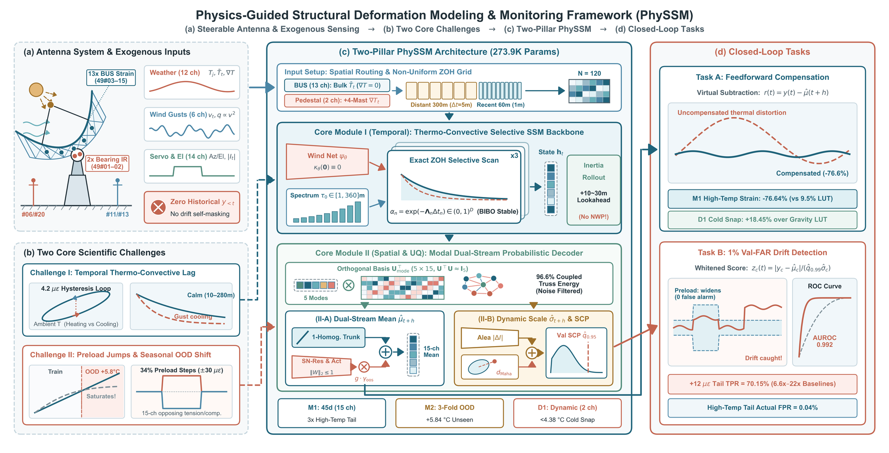

<div align="center">

# PhySSM: Physics-Guided State-Space Model for Large-Aperture Antenna Structural Deformation Modeling and Monitoring

[](https://www.python.org/)
[](https://pytorch.org/)
[](LICENSE)
[](#data-and-weights-availability)

**Bowen Yu<sup>1,*</sup>, Jingyi Zhu<sup>1,*</sup>, Wenxian Yang<sup>2</sup>, Liuyang Zhang<sup>1,†</sup>, Ruqiang Yan<sup>1</sup>, Xuefeng Chen<sup>1</sup>**

<sup>1</sup> *School of Mechanical Engineering, Xi'an Jiaotong University, Xi'an, Shaanxi, 710049, China*  
<sup>2</sup> *School of Computing and Engineering, University of Huddersfield, Huddersfield, HD1 3DH, UK*  
<sup>*</sup> Equal contribution &nbsp;|&nbsp; <sup>†</sup> Corresponding author (`liuyangzhang@xjtu.edu.cn`)

</div>

---

<p align="center">
  
</p>

## Overview

**PhySSM** is a compact (**273.9K trainable parameters**, ~1.1 MB FP32) **Physics-Guided State-Space Model** designed for **strictly exogenous** healthy structural deformation soft sensing, seasonal out-of-distribution (OOD) extrapolation, and structural health monitoring (SHM) of outdoor large-aperture steerable radio telescopes.

Unlike generic autoregressive forecasters that ingest historical deformation readings ($\mathbf{y}_{<t}$) and suffer from anomaly self-masking or probe-shutdown failure, PhySSM maps strictly from exogenous environmental and servo telemetry ($\mathbf{U}_{t-L+1:t} \in \mathbb{R}^{360 \times 32}$) to calibrated multi-channel predictive distributions $(\hat{\boldsymbol{\mu}}_{t+h}, \hat{\boldsymbol{\sigma}}_{t+h})$:

- **Subsystem Spatial Routing & Non-Uniform ZOH Grid:** Decouples local ground-tower shadow gradients (routed exclusively to elevation pedestal bearings) from elevated steel backup-structure (BUS) strain channels, while compressing 6-h history ($360 \to 120$ steps: $60 \times 5\text{ min} + 60 \times 1\text{ min}$) without losing thermal memory or transient resolution.
- **Core Module I — Thermo-Convective Selective SSM Backbone:** Exact zero-order-hold (ZOH) diagonal dissipative state-space scan ($\mathcal{O}(\log N)$ associative parallel prefix scan) with strictly positive still-air time constants $\boldsymbol{\tau}_0$ and calm-anchored wind modulation ($\kappa_\theta(\mathbf{0}) \equiv \mathbf{0}$), proving **unconditional BIBO stability and convex-hull preservation** under arbitrary OOD amplitudes.
- **Core Module II — Modal-Constrained Extrapolation-Safe Probabilistic Decoder:** Mesh-free learnable Stiefel orthogonal modal basis ($\mathbf{U}_{\mathrm{mode}} \in \mathbb{R}^{C \times r}$, $\mathbf{U}^\top \mathbf{U} \approx \mathbf{I}_r$) coupling an activation-free **1-homogeneous linear trunk** (preventing OOD saturation) with spectrally normalized, regime- and Mahalanobis-gated residuals.
- **Stop-Gradient CRPS & Split-Conformal Calibration (SCP):** Separates transient operational aleatoric volatility ($|\Delta \mathbf{u}_{5\mathrm{m}}^{\mathrm{op}}|$) from Mahalanobis epistemic OOD uncertainty ($\tilde{d}_t$) via closed-form Gaussian CRPS with stop-gradient decoupling and uniform validation SCP.

---

## Key Benchmark Highlights

Across **276 zero-leakage experiments** spanning 60 operational days ($46.3\text{ million}$ raw records) of an in-service large-aperture antenna against seven cross-paradigm baselines (**Composite-GPR**, **N4SID**, **VMD-BiLSTM**, **Causal-Dilated TCN**, **ST-GAT**, **TimeXer**, and **TimePro**):

| Evaluation Protocol | Regime / Challenge | PhySSM (Ours) | Best Competing Baseline | Key Gain |
| :--- | :--- | :---: | :---: | :--- |
| **Split M1** (45 d, 15 ch) | 13-Ch BUS Strain RMSE / CRPS | **2.867 / 1.434** $\mu\varepsilon$ | 3.098 / 1.569 $\mu\varepsilon$ (TCN) | **$-7.5\%$ RMSE**, **$-8.6\%$ CRPS** ($40.9\%$ fewer params) |
| **Split M2** (3-Fold Rolling) | Unseen $+5.84\,^\circ\mathrm{C}$ Warm-OOD RMSE | **2.730** $\mu\varepsilon$ | 3.426 $\mu\varepsilon$ (TimePro) | **$-20.3\%$ to $-31.2\%$** vs. deep baselines |
| **Split M2** (3-Fold Rolling) | Warm-OOD Conformal Coverage (PICP95) | **95.9%** (width $13.06\,\mu\varepsilon$) | 76.1%–92.0% (deep) | Preserves $\ge 95\%$ safety floor ($3.2\times$ tighter than GPR) |
| **Split D1** (2025 Dynamic El) | Unseen $<4.38\,^\circ\mathrm{C}$ Cold-OOD Disp. | **0.0971 mm** | 0.1350 mm (N4SID) | **$-28.0\%$** vs. N4SID, **$-33.9\%$** vs. TCN |
| **Task A** (Offline Feedforward) | M1 OOD Thermal / D1 Cold Gain vs. LUT | **76.64%** / **+18.45%** | 76.12% / $-13.33\%$ | **Sole model** with positive Cold-OOD net gain over Grav-LUT |
| **Task B** (1% Val-FAR Drift) | $+12\,\mu\varepsilon$ Drift OOD TPR (AUROC) | **70.15%** (**0.9923**) | 52.63% (TCN) / 1.51%–26.2% (others) | Overall TPR **48.64%** (**$6.6\text{--}22\times$** baselines) at **0.04%** OOD FPR |

White-box physical diagnostics further confirm physically consistent still-air thermal lags (**61.4–78.4 min**, matching lumped-capacitance steel-truss theory of 32–128 min), spontaneous concave convective wind scaling ($r = +0.96$), and an emergent orthogonal latent coordinate frame ($\text{Servo Preload} \perp \text{Thermal Bath}$).

---

## Repository Structure

```text
PhySSM/
├── assets/
│   └── framework.png                         # Overall research framework diagram
├── configs/
│   └── default_benchmark_config.json         # Unified feature schema, splits, and hyperparameters
├── src/
│   ├── ssm_scan.py                           # Exact non-uniform ZOH associative parallel prefix scan O(log N)
│   ├── data_pipeline.py                      # Strictly exogenous causal dataset, zero-leakage scalers & splits
│   ├── metrics_and_calibration.py            # RMSE, MAE, CRPS, PICP95, MPIW95, Diebold-Mariano & SCP
│   ├── palette.py                            # Consistent visualization color palette
│   └── models/
│       ├── __init__.py                       # Unified registry for PhySSM, 7 baselines, and ablations
│       ├── physsm.py                         # PhySSM core architecture (Modules I & II + D1 Ridge anchor)
│       ├── traditional_and_sysid.py          # Composite-GPR & Schur-stabilized N4SID
│       ├── industrial_dl.py                  # VMD-BiLSTM, Causal-Dilated TCN, and ST-GAT
│       └── frontier_ts.py                    # TimeXer and TimePro
├── scripts/
│   ├── quickstart_synthetic_demo.py          # 5-second synthetic smoke test (no private data needed)
│   ├── run_single_experiment.py              # Single-run trainer, validator, and SCP calibrator
│   ├── gpu_queue_runner.py                   # Multi-GPU reproducible benchmark & ablation scheduler
│   ├── infer_from_checkpoint.py              # Standalone zero-leakage inference & ensemble CLI
│   ├── preprocessing/
│   │   └── build_clean_datasets.py           # Deterministic data hygiene & 1-min canonical aggregation
│   └── analysis/
│       ├── summarize_main_experiments.py     # Main benchmark, Deep Ensemble & multi-horizon tables
│       ├── summarize_ablation_experiments.py # Cross-protocol orthogonal ablation & modal rank tables
│       └── run_mechanism_analysis.py         # Hysteresis, convective scaling, latent probes, Tasks A & B
├── requirements.txt
├── LICENSE
└── README.md
```

---

## Installation

Python 3.10+ and PyTorch 2.1+ are recommended (tested on CUDA 11.8/12.x and CPU):

```bash
git clone https://github.com/ybw110/PhySSM.git
cd PhySSM
pip install -r requirements.txt
```

---

## Quickstart (Synthetic Smoke Test)

To verify the installation, exact parameter count (`273.9K`), **Proposition 1** BIBO stability under extreme OOD forcing, decoupled CRPS + Stiefel training step, and all deep baseline interfaces without requiring observatory data:

```bash
python scripts/quickstart_synthetic_demo.py
```

---

## Running Full Benchmarks on Compatible Telemetry

Once canonical 1-minute CSV files matching the 32-D exogenous schema in `configs/default_benchmark_config.json` are placed under `data/processed_2026_1min/` and `data/processed_2025_1min/` (or produced via `scripts/preprocessing/build_clean_datasets.py`):

### 1. Single Experiment (Training + Validation SCP Calibration)
```bash
# Train PhySSM on Split M1 (seed 42) and save a self-contained checkpoint
python scripts/run_single_experiment.py \
    --split M1 \
    --model PhySSM \
    --seed 42 \
    --horizon 0 \
    --save_checkpoint
```

### 2. Multi-GPU Benchmark & Cross-Protocol Ablation Queue
```bash
# Main benchmark on Split M1 (8 models x 5 seeds)
python scripts/gpu_queue_runner.py --stage m1_main --gpus 0,1,2,3

# Severe seasonal extrapolation (Split M2 3-fold) & dynamic Cold-OOD (Split D1)
python scripts/gpu_queue_runner.py --stage m2_d1_main --gpus 0,1,2,3

# Forecast-free multi-horizon lookahead (H = 10, 30, 60 min)
python scripts/gpu_queue_runner.py --stage horizons --gpus 0,1,2,3

# Cross-protocol orthogonal ablations (M1 + M2 + D1) & modal rank sensitivity
python scripts/gpu_queue_runner.py --stage ablations --gpus 0,1,2,3
```

### 3. Quantitative Aggregation & Physical Mechanism Audits
```bash
python scripts/analysis/summarize_main_experiments.py
python scripts/analysis/summarize_ablation_experiments.py
python scripts/analysis/run_mechanism_analysis.py
```

### 4. Standalone Inference from a Trained Checkpoint
```bash
python scripts/infer_from_checkpoint.py \
    --checkpoint checkpoints/M1_PhySSM_h0_ablnone_s42.pt \
    --split M1
```

---

## Data and Weights Availability

This public repository releases **source code and experiment configurations only**. Raw operational telemetry from the in-service large-aperture radio telescope and checkpoints trained directly on proprietary observatory logs are excluded due to institutional confidentiality agreements. All modeling, conformal calibration, ablation, and mechanism-analysis code can be directly audited and executed on synthetic or user-provided exogenous structural monitoring datasets following the documented 32-D schema.

---

## Acknowledgements

This work was supported by the National Natural Science Foundation of China under Grant **92360306** and Grant **52675170**.

---

## Citation

If you find this codebase or methodology useful in your research, please consider citing:

```bibtex
@article{yu2026physsm,
  title   = {PhySSM: Physics-Guided State-Space Model for Large-Aperture Antenna Structural Deformation Modeling and Monitoring},
  author  = {Yu, Bowen and Zhu, Jingyi and Yang, Wenxian and Zhang, Liuyang and Yan, Ruqiang and Chen, Xuefeng},
  journal = {Mechanical Systems and Signal Processing (Under Review)},
  year    = {2026},
  url     = {https://github.com/ybw110/PhySSM}
}
```
